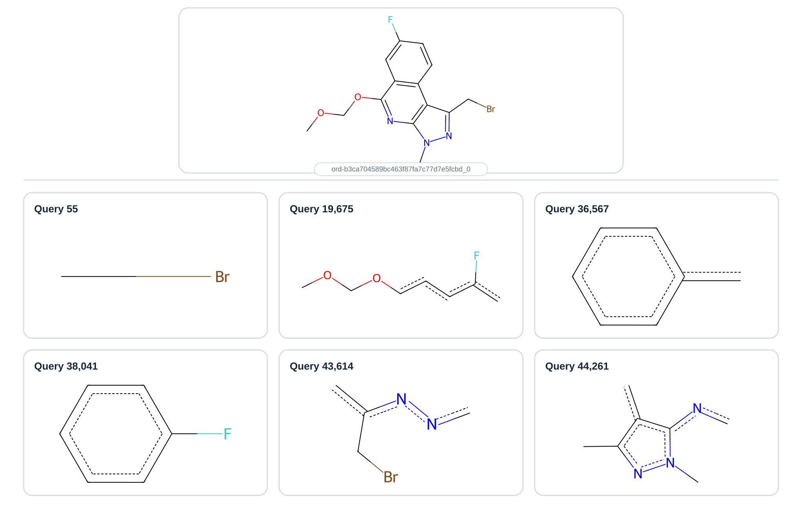

> [!NOTE] Updated in November 2026
> The first version of this post stopped at the NumPy inverted index.
> This version follows the talk we gave at a meetup in Kraków on 2026-10-28.
> It adds the Rust part, written together with my former colleague
> [Marcin Kowiel](https://www.linkedin.com/in/marcin-kowiel-60baaa176/), who did most of
> Rust-related work.
> All numbers come from a single new benchmark run (2026-10-11), so some differ slightly
> from the first version.

One of the most insightful talks at [RDKit UGM 2026](https://github.com/rdkit/UGM_2026)
was [Maciej Wójcikowski](https://www.linkedin.com/in/mwojcikowski/)’s talk about using
roaring bitmaps to speed up substructure searches.
Having some time in the evening after the UGM and during the hackathon, I decided to
take a closer look. What started as an evening experiment grew into a benchmark with
eleven variants, a custom fingerprint and a small native substructure matcher in Rust.

**TL;DR.** On a single core of an Apple M4, matching 1,000 molecules against 50,000
SMARTS queries goes from **77 s** with a naive RDKit loop to **0.6 s** end to end in
native Rust, of which the matching itself takes 51 ms.
Three things got us there, in order of importance: test fewer pairs (an inverted index),
make the screen more specific (a query-aware fingerprint), and get out of the per-pair
Python/RDKit loop entirely.

The benchmark code is available in the
[roaring-substructure repository](https://github.com/asiomchen/roaring-substructure).

## The problem: which templates apply to this molecule?

Imagine you have a large corpus of SMARTS substructures (>50k) and want to find which
ones are present in a molecule.
Maciej talked about this approach being used in Merck’s
[Synthia](https://www.sigmaaldrich.com/DE/en/services/software-and-digital-platforms/synthia-retrosynthesis-software)
retrosynthesis software.
That makes sense if you have reaction templates and want to know which ones match the
starting molecule. Most of the approaches described here can also speed up the search in
the opposite direction.

For the benchmark, I used the `uspto-grants` subset of
[`ord-data`](https://github.com/open-reaction-database/ord-data): 1.77 million
chemical reactions mined from United States patent grants.
These reactions are atom-mapped, so we can use AstraZeneca’s
[`reaction-utils`](https://github.com/MolecularAI/reaction_utils) library to get
reasonably good templates.
I sampled 50,000 unique templates as substructures and 1,000 unique reactants for the
searches.

|  |  |
| --- | ---: |
| SMARTS queries (USPTO templates) | 50,000 |
| reactants | 1,000 |
| pairs to decide in the worst case | 50,000,000 |
| real matches | 27,723 (0.055%) |

Almost every pair is a non-match.
So the whole game is to reject the other 99.9% cheaply and spend real work only on the
few plausible pairs.



*One of the reactants used in the benchmark, shown with six matching substructures.*

> [!NOTE] How the times are reported
> Everything runs on **one thread** of an Apple M4 (Python 3.13, RDKit 2026.03.6, rustc
> 1.98).
> For the Python methods we quote **end-to-end** time: parse the queries, build the index,
> prepare the reactants, then the median of three matching runs.
> Matching time on its own is given in brackets.
> The same applies to every method in the post, Python and Rust alike.

## Naive approach: 77 seconds

Like Maciej, I started with a naive approach: test each molecule against each query in a
loop. Not very creative, but it works.

```python
matches = []
for r_mol in reactants:
    for s_mol in queries:
        if r_mol.HasSubstructMatch(s_mol):
            matches.append(...)
```

**77.2 s** (76.3 s matching): 50 million substructure match calls at about 1.5 µs each.
Probably fine for a one-time search, but it doesn’t scale with the template library.

Before any algorithm work, removing plain Python overhead mattered.
Iterating over a pandas `Series` in the inner loop costs 3.7× as much as iterating over
a list.

## Screen cheaply, then match exactly

Every faster variant below uses the same idea, in three steps:

1. **Fingerprint.** Hash the structural features of each molecule and each query into a
   fixed-size bit vector.
2. **Subset test.** Are all the query’s bits also set in the molecule’s fingerprint?
   If not, the query cannot match.
3. **Exact match.** Run the graph match only on the pairs that survive.

There are no false negatives by construction: every query feature that is present in the
molecule sets the same bit.
The screen only lets through false positives, and the exact match removes them.
This is also the strategy of the PostgreSQL RDKit cartridge, which we’ll get to shortly.

## PatternFingerprint: 25.9 seconds

The first screen is the one suggested by Maciej (and the RDKit documentation): the
`PatternFingerprint`, a 2,048-bit fingerprint built from a set of generic patterns.

```python
def to_pattern(mol):
    return PatternFingerprint(mol)

for r_mol in reactants:
    r_fp = to_pattern(r_mol)
    for s_mol, s_fp in zip(queries, queries_fp):
        if not AllProbeBitsMatch(s_fp, r_fp):
            continue
        if r_mol.HasSubstructMatch(s_mol):
            matches.append(...)
```

**25.9 s** (22.4 s matching), about 3× faster.
Only **350,393** pairs reach the exact match instead of 50 million.

## Roaring bitmaps: 11.2 seconds

Here comes the main topic: roaring bitmaps.
At the UGM, only Andrew Dalke raised his hand when asked whether anyone had experience
with them. More exotic data structures are apparently not that common in the
cheminformatics world.

Roaring bitmaps are compressed bitmaps promising us fast AND, OR and subset operations,
and that’s exactly what we want.
All it takes is installing `pyroaring` and converting the fingerprint to a bitmap:

```python
from pyroaring import BitMap

def to_pattern(mol):
    return BitMap(PatternFingerprint(mol).GetOnBits())

for r_mol in reactants:
    r_fp = to_pattern(r_mol)
    for s_mol, s_fp in zip(queries, queries_fp):
        if not s_fp.issubset(r_fp):
            continue
        if r_mol.HasSubstructMatch(s_mol):
            matches.append(...)
```

**11.2 s** (6.2 s matching), another 2.3× from a three-line change.

On memory: up to 4,096 values per block of 65,536 IDs, Roaring stores each set value as
a 2-byte integer, which is 16 bits per set bit.
A dense bitmap pays 1 bit for every possible position.
So Roaring is smaller whenever fewer than 1 in 16 bits are set.

But this version still visits all 50 million pairs.
The subset test is now cheap, and the scan itself is the cost.

## PostgreSQL 18 + the RDKit cartridge: 7.9 seconds

To complete the set of approaches from Maciej’s talk, I tried the Postgres cartridge
(according to the RDKit survey, 20% of users use it, can you believe it?). The queries
go into a column of the query-molecule (`qmol`) type with a GiST index, and the search
runs one molecule at a time, over a single connection and 1 CPU core limit.

Searching the existing table takes **7.9 s**. Loading the table and building the index
take another **8.3 s**, so comparing it with the end-to-end numbers above is not quite
fair to either side.
With **10 connections** (and all 10 cores available) the search drops to about **1.6
s**, but that is multiprocessing, and everything here is single-threaded.

Why isn’t the index faster?
The cartridge was designed for the other direction.
Its GiST index stores a `PatternFingerprint` per row, and each parent node stores the OR
of its children’s fingerprints.

| direction | test at a leaf | test at an inner node |
| --- | --- | --- |
| `mol @> qmol`: table of molecules, one query | query ⊆ key | query ⊆ key, **the same test** |
| `qmol <@ mol`: table of queries, one molecule (this benchmark) | key ⊆ molecule | key ∩ molecule ≠ ∅, **overlap only** |

When you search a table of molecules with one query, one query bit missing from a parent
key rules out the whole subtree, often hundreds or thousands of rows at once.
In our direction a parent can only be skipped if it shares *no* bits with the molecule,
which almost never happens high in the tree.
So the index still works as a fast fingerprint screen written in C, but it can’t prune.
It also always rechecks every surviving row with a real substructure match.

## Invert the index: rule out queries in bulk

To stop testing every pair, I built another structure on top of roaring bitmaps: a
postings list, also known as an inverted index.
In a search engine, postings map each word to the documents that contain it.
Here the “word” is a fingerprint bit, and the documents are the queries that set it.

The trick is to use the bits the molecule **lacks**. A query can only match if every one
of its bits is also set in the molecule.
So a bit that is absent from the molecule rules out every query that has it, and one OR
of that bit’s posting bitmap removes them all.

1. **Build once.** For each fingerprint bit, store a bitmap of the IDs of the queries
   that set it. Rank the bits by how many queries use them.
2. **For each molecule**, walk that ranking and take up to 128 frequent bits the
   molecule doesn’t have.
3. OR their postings: every query in the union needs a missing feature, so drop them
   all.
4. Run the usual full subset test and exact match on the rest.


In the benchmark, the 128 ORs per molecule remove 98.1% of the pairs: 50 million pairs →
943,741 → 350,393 after the full fingerprint check → 27,723 matches.
The number of postings only trades speed.
The full check keeps the result exact whatever the number.

With roaring postings the search takes **7.45 s** end to end (1.68 s matching).

I also wanted to check whether NumPy could compete.
Codex/GPT-5.6-Sol helped me a lot here.
We ended up storing each 2,048-bit fingerprint as 32 packed `uint64` words and each
posting list as a packed bit array, then using bitwise operations over whole arrays.
That gives **6.81 s** (1.28 s matching).

Is it clever? Probably.
Was it a NumPy learning experience for me?
Definitely. Would I like to support this code?
Probably not. The roaring version is much more intuitive and readable.


*End-to-end time of the Python methods, split into query preparation, index building,
reactant preparation and matching.
Index building now takes most of the time.
The “path fp” rows are explained in the next section.*

## A query-aware path fingerprint

At this point matching takes about 1.3 s, and much of it is RDKit’s exact match on
350,393 candidate pairs.
To make the exact match run less often, the screen has to be more specific.

RDKit’s `PatternFingerprint` keeps only three facts about a query: which elements are
bonded to which, the bond orders, and how often each small shape occurs.
It ignores everything else the SMARTS states, including hydrogen counts, degree and
charges. Reaction templates state a lot of those.
In `[C&H2&D2&+0]` the fingerprint sees only “a carbon”.


This is a design choice in RDKit -
[rdkit#151](https://github.com/rdkit/rdkit/issues/151) and
[rdkit#1496](https://github.com/rdkit/rdkit/issues/1496) show the rule RDKit learned the
hard way: a pattern-fingerprint feature must be something a larger molecule can’t take
away. Ring membership or the neighbour count of a query fragment can differ in the full
molecule, so including them risks false negatives.

Our fingerprint (`paths4`) keeps that guarantee and uses the query information more
fully:

- It hashes labelled atoms and paths of up to four bonds, and counts repeated features.
- A query hashes **only the labels its SMARTS actually states**: H count, degree, charge
  and aromaticity. An unconstrained part of the query becomes an “open” label, which
  stops path emission.
- A molecule hashes every label at every level of detail, so any feature a query can
  state is also present on the molecule side.

With the same inverted index, the number of exact matches drops from 350k to about
**90k**, 3.9× fewer.

In Python, though, the new fingerprint makes the index **about 3.5× slower to build**
(4.8 s → 16.8 s). Matching gets a little faster (1.01 s), but end to end it is a loss,
as the “path fp” rows above show.
Next stop: Rust.

## Take RDKit out of the hot loop

The Rust part is joint work, and Marcin did the majority of it, guiding Claude through
it, the query-aware fingerprint from the previous section and most of the tuning.

Rust compiles to machine code ahead of time.
[PyO3](https://pyo3.rs) exposes Rust functions and classes as ordinary Python modules,
and [maturin](https://www.maturin.rs) builds and packages them, so `uv run` rebuilds the
extension when needed.
We took two steps.

### Step 1: move only the screen into Rust: 6.16 seconds

Python still parses everything with RDKit and computes the `PatternFingerprint`. Rust
stores the query fingerprints as 32 `u64` words each, builds the 2,048 postings, and
does the screen.

End to end the search goes from 6.81 s to **6.16 s** (1.06 s matching), only about 10%
faster. Most of the time is still the 4.4 s index build, because Python asks RDKit for
the `PatternFingerprint` of each of the 50,000 queries.
And even inside the matching step, the screen was not where the time went.
Timing the stages separately (in an earlier, separate run of the same benchmark, about
1.07 s in total):

| stage | time | share |
| --- | ---: | ---: |
| RDKit `PatternFingerprint` for 1,000 reactants | 0.143 s | 13% |
| Rust screen (postings + full subset test) | 0.033 s | 3% |
| RDKit `HasSubstructMatch`, 350,393 calls from a Python loop | 0.897 s | 84% |

Making the screen faster isn’t enough while every candidate still crosses into RDKit.
`HasSubstructMatch` is the bottleneck.

### Step 2: the whole pipeline native: 0.62 seconds

The second crate, `substructure_rs`, does everything in Rust, and the Python file is
only a thin wrapper:

- its own SMILES and SMARTS parsers, sanitization and ring perception;
- the query-aware path fingerprint from the previous section;
- the same inverted-index screen;
- its own VF2-style backtracking matcher for the exact match.

End to end the search takes **0.62 s** (0.071 s matching), 10× faster than step 1. The
time is now mostly the index build (0.43 s, see the next section), and the SMARTS
parsing (0.11 s).

Matching itself got 15× faster (1.06 s → 0.071 s). Most of that gain comes from doing
less work, not from a faster language:

- **Fewer exact matches (≈4×):** about 90k candidates instead of 350,393.
- **Cheaper work per candidate (≈3×):** about 0.8 µs per candidate for *everything*
  (fingerprint, screen and exact match), against about 2.6 µs for a single RDKit
  `HasSubstructMatch` call from Python.
- **No separate fingerprint pass:** reactant fingerprints are computed inside the
  matching loop.

The SMARTS parser started with just the subset these templates use and has grown since.
It now covers elements, `#n`, `a`, `A` and `*`; isotopes (`[13C]`); H count, degree,
total connectivity (`X`), valence, charge and ranges such as `D{1-3}`; ring membership,
ring size and ring bonds (`R`, `r`, `x`); heteroatom neighbours (`z`, `Z`); recursive
SMARTS (`$(...)`); negation, conjunction and alternatives; and all the usual bond types,
including ring bonds (`@`).

As a sanity check we also ran [chematic](https://crates.io/crates/chematic-core), a
general-purpose pure-Rust toolkit.
Matching every pair takes 19.8 s end to end, about 4× faster than RDKit’s naive loop.
Behind our screen it takes 0.84 s (0.157 s matching, about 2× slower than our 0.071 s
matcher), and it returns exactly the same matches as RDKit.


*End-to-end time, Python against Rust.
Once the whole pipeline is native, the full run from SMARTS strings to matches takes
about 0.6 s, and index preparation is the largest part of it.*

## Building the index: 17 s → 0.45 s

In the Rust pipeline, building the index is most of the end-to-end time, so this is
where the code pays off most.
It also fixes the problem that made the path fingerprint a loss in Python.

| pipeline (50,000 queries, one thread) | query parse | index build |
| --- | ---: | ---: |
| NumPy + RDKit Pattern | 0.65 s | 4.8 s |
| NumPy + path fingerprint in Python | 0.67 s | 16.8 s |
| native Rust (`paths4+branches`) | 0.11 s | 0.45 s |

- **Native parsing and fingerprinting:** our own SMARTS parser, with no RDKit `Mol` and
  no Python call per query.
- **Cheaper hashing:** feature counting with a hash table and incremental path hashes.
- **Postings in one pass:** a single flat `u64` array, filled by walking each query’s
  set bits with `trailing_zeros`.

An index you build once should not have to be rebuilt for every search, so benchmark 11
saves it to disk and loads it in a separate process:


*Build once, then load and search.
With a saved index, a search from loading the index to the final matches takes 0.33 s in
Rust against about 2 s in Python.
The Rust index is a quarter of the size on disk and uses a third of the memory.*

## Fine-tuning the matcher: 115 → 50 ms of matching

With the algorithm in place, the rest was profiling and tuning the matching step.
This section is the exception to the end-to-end rule: the changes only affect matching
time. 
Each change kept the result identical (same 27,723 matches, same digest):

| change | effect |
| --- | --- |
| packed atom tests: atom properties in one `u64`, SMARTS turned into mask tests | exact match 45 → 24 ms |
| feature counting with a hash table instead of a sort | fingerprint −40% |
| tight root scan + one `Step` struct per search step | 282 → 223 ns per pair |
| rare-root order: start the search at the rarest query atom | 223 → ~190 ns per pair |
| incremental polynomial path hashing | fingerprint −30–50%, depending on the kind |
| fingerprint sweep (50 configurations) | `paths4+branches`, 2,048 bits |

The diagnostic flags drove most of this.
`--search-stats` showed that scanning for the root atom dominated, which led to
rare-root ordering. Other ideas, like reusing buffers, saved nothing.
Lesson: measure first, don’t assume what is slow.

The fingerprint sweep tried 10 kinds of features at five sizes (matching time):


- **The kind of fingerprint matters most.** Atom labels alone send about 3 million pairs
  to the exact match, and paths of up to 2 bonds about 240–390 thousand.
  Paths of 4 bonds or more get it below 100 thousand at 2,048 bits and above.
  Counting repeated features matters too: `paths4` without counts sends 1.7× more pairs.
- **Size has an optimum.** Larger fingerprints always send fewer pairs, but beyond 2,048
  bits the gain is small and comparing longer fingerprints costs more.
- **The winner is `paths4+branches` at 2,048 bits:** 50 ms and 82,461 exact matches,
  4.2× fewer than RDKit’s Pattern.
  Adding rings sends fewer pairs (75k) at the same speed, within run-to-run noise.
- **Every one of the 50 configurations returns the same 27,723 matches**, so the
  fingerprint only affects speed, never the result.

The next target is the posting filter, which at about 15 ms now costs as much as
fingerprinting or exact matching.

## Results: from 77 s to 0.6 s

Same 50 million pairs and the same 27,723 matches in every row, one thread:

| method | end to end | matching | pairs sent to exact match |
| --- | ---: | ---: | ---: |
| naive RDKit, every pair | 77.2 s | 76.3 s | 50,000,000 |
| RDKit `PatternFingerprint` | 25.9 s | 22.4 s | 350,393 |
| Pattern fp as roaring bitmaps | 11.2 s | 6.15 s | 350,393 |
| PostgreSQL 18 cartridge, one connection | 16.2 s | 7.92 s | — |
| roaring inverted index | 7.45 s | 1.68 s | 350,393 |
| NumPy inverted index | 6.81 s | 1.28 s | 350,393 |
| Rust screen + RDKit match | 6.16 s | 1.06 s | 350,393 |
| native Rust, `paths4` 4,096 bits | **0.62 s** | 0.071 s | 90,417 |
| native Rust, tuned (`paths4+branches` 2,048 bits) | 0.63 s | **0.051 s** | 82,461 |

End to end, the native pipeline is about 120× faster than the naive loop and about 11×
faster than the best NumPy + RDKit version.
With the index already saved to disk, a search takes 0.33 s. Matching alone is about
1,500× faster than the naive loop.

Our queries are very specific SMARTS with many stated labels.
That favours the query-aware fingerprint.
With more diverse, less specific queries, the gap would be smaller.

## Vibe matching: writing the Rust version was easier than expected

Much of the Rust code here was written by Claude (Opus 5.5 at medium effort, in Claude
Cowork), with Marcin guiding it: setting the tasks, reviewing the results and deciding
what to measure next.

A benchmark is a well-defined task by design.
It has fixed input, an expected output (the same 27,723 matches and digest) and an
obvious metric to optimise (time).
Models are very efficient at that kind of task when there is a comprehensive test set.
A simple prompt can be enough:

```
/loop 10m reimplement numpy benchmark in rust. Commit changes to separate branch,
write unit tests and merge when all test passes.
```

So
[letting models do the benchmarking](https://patwalters.github.io/Let-the-Agents-Do-the-Benchmarking/)
can give you a very good head start with minimal manual effort.

Models do sometimes start from wrong assumptions about what is slow, so measure rather
than trust. And is the result robust and production-ready?
We doubt it. But Claude implemented a lot of the needed logic correctly.

Running the Rust version we even had the “uv moment”: it was so fast that we wondered
whether it had really finished or we were looking at the previous results.

## What to take home

- **Don’t test every pair.** Postings for absent bits rule out thousands of queries per
  OR.
- **Make the screen specific.** A query-aware fingerprint cuts exact matches 4×.
- **Go native end to end.** Rust for the filter alone gave −10%. The whole pipeline in
  Rust gave 10×.
- **Measure, then tune.** Search statistics pointed at the root scan, while reusing
  buffers saved nothing.

The right algorithm and data structure come first, then an efficient implementation on
top of them.
And LLMs are great at well-constrained problems, especially when they have a
comprehensive test set.

## Errata: what’s next

RDKit is 370k+ lines of C++ and 50k+ lines of Python.
So, naturally, Marcin has started rewriting the whole of it in Rust, with Python
bindings: [rdoxide](https://github.com/mkowiel/rdoxide).

```python
from rdoxide import Chem
```
